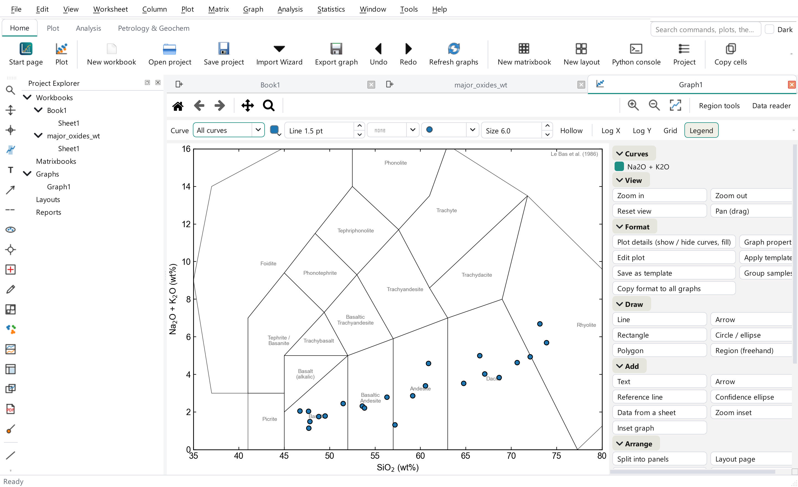

# PlotBench

**Scientific graphing, peak fitting, petrology, thermobarometry and geochronology in one free desktop app.**

PlotBench takes you from a spreadsheet of analyses (EPMA, LA-ICP-MS, XRF, isotope ratios, Raman or XRD spectra) to
publication-ready figures without writing code. It runs on Windows, macOS and Linux and needs no Python, R or MATLAB installation.

[](https://doi.org/10.5281/zenodo.24330955)

**Website:** https://plotbench.vercel.app/ &nbsp;·&nbsp; **Download:** [latest release](https://github.com/kishangeo/PlotBench/releases/latest)



## What it does

- **Worksheets and graphs.** Spreadsheet-style workbooks, 83 plot types, journal-sized export (PNG, TIFF, PDF, SVG, EPS) with a true-size preview, multi-panel figures with (a), (b), (c) labels.
- **Fitting and spectroscopy.** Linear, polynomial and 47 nonlinear models; a Peak Analyzer with baselines, Gaussian, Lorentzian, pseudo-Voigt and Voigt peaks, and peak areas for Raman, FTIR and XRD spectra.
- **Statistics.** Descriptive statistics, t-tests, ANOVA, non-parametric tests, PCA, clustering, discriminant analysis, regression and mixed models.
- **Geochemistry.** TAS, AFM, Harker, Frost, Shand, Pearce granite and basalt discrimination diagrams, chondrite- and mantle-normalised spider diagrams, ternary plots, CIPW norm.
- **Mineral chemistry.** Mineral formulae from oxide wt%, with Fe<sup>3+</sup> by charge balance (Droop 1987), and amphibole, pyroxene and feldspar classification.
- **Thermobarometry.** 45 mineral and mineral-melt thermometers, barometers and oxybarometers (for example Putirka 2008, Holland & Blundy 1994, Ti-in-zircon, Ti-in-quartz, Zr-in-titanite, the Ghiorso & Evans 2008 Fe-Ti oxide model, the Loucks et al. 2020 zircon oxybarometer), and a solver that finds P and T together from a thermometer and a barometer.
- **Geochronology.** Wetherill and Tera-Wasserburg concordia, concordia and weighted-mean ages, York isochrons, common-Pb correction (Stacey & Kramers 1975), discordance filtering, detrital KDE and PDP plots.
- **Your data stay linked.** Results are written back into the sheet as new columns; masked rows drop out of every plot and calculation; graphs redraw when the data change.

A user manual with screenshots is built in (Help > User Manual, F1), and 27 example data sets open with a finished graph.

## Download and install

| System | File | Notes |
|---|---|---|
| Windows 10/11 | `PlotBench-<version>-Setup.exe` | Run the installer. It installs for your user only, so no administrator rights are needed. |
| macOS (Apple silicon) | `PlotBench-<version>-macos-arm64.dmg` | Open the disk image and drag PlotBench to Applications. |
| macOS (Intel) | `PlotBench-<version>-macos-intel.dmg` | As above. |
| Linux (x86-64) | `PlotBench-<version>-linux-x86_64.tar.gz` | Unpack, then run `./PlotBench`, or `./install.sh` to add it to your applications menu. |

All files are on the [Releases page](https://github.com/kishangeo/PlotBench/releases/latest).

The Windows and macOS builds are not code-signed or notarised. Download them only from the Releases page, and compare the file with the
SHA-256 checksum shown there.

- **macOS:** the first time, macOS says it "could not verify" PlotBench. Click **Done**, open **System Settings > Privacy & Security**, and click
  **Open Anyway** next to the PlotBench message. Or run `xattr -dr com.apple.quarantine /Applications/PlotBench.app` once in Terminal.
- **Windows:** SmartScreen may warn about an unrecognised app; choose **More info** to see the publisher and file before deciding to run it.

## Run from source

Needs Python 3.10 or newer.

```bash
git clone https://github.com/kishangeo/PlotBench.git
cd PlotBench
python -m venv .venv
.venv/bin/pip install -r requirements.txt        # Windows: .venv\Scripts\pip install -r requirements.txt
.venv/bin/python run_plotbench.py                # Windows: .venv\Scripts\python run_plotbench.py
```

The `test_*.py` scripts and `python -m unittest discover -s tests` check the program; `python validation/validate.py` benchmarks the
thermobarometry against published worked examples and experiments and writes [VALIDATION.md](VALIDATION.md). `build.ps1` builds the
Windows installer.

## Citing PlotBench

If PlotBench helps your work, please cite it:

> Tiwari, K. (2026). *PlotBench: a desktop workbench for scientific graphing, petrology, thermobarometry and geochronology* (Version 1.30.1)
> [Computer software]. Zenodo. https://doi.org/10.5281/zenodo.24330956

To cite whichever version is newest, use the all-versions DOI https://doi.org/10.5281/zenodo.24330955. GitHub's **Cite this repository**
button (from [`CITATION.cff`](CITATION.cff)) gives the reference in APA and BibTeX. Every diagram and calculation in the app also names the paper it comes from; please cite those too.

## Feedback

Bug reports and suggestions are welcome on the [issue tracker](https://github.com/kishangeo/PlotBench/issues), or by e-mail to
Kishan Tiwari (kishantiwari@iitkgp.ac.in).

## License

PlotBench is free and open-source software under the [MIT License](LICENSE). It is built on Qt for Python (PySide6, LGPL), NumPy, SciPy,
pandas and matplotlib.
